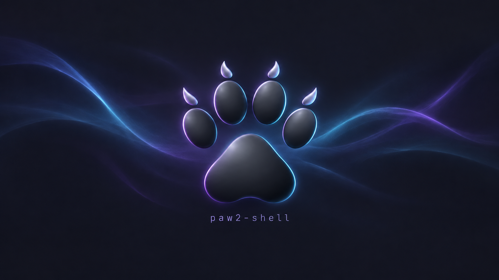

<p align="center">
  
</p>

<h1 align="center">paw2-shell</h1>

<p align="center">
  The desktop shell for the <a href="https://github.com/CodyWan1990/paw2">paw2</a> Wayland compositor:
  bar, dock, launcher, notifications, lock screen, themes and settings, all in one place.
</p>

<p align="center">
  
</p>

## A note on how this is made

Most of paw2-shell's code is written with the help of AI coding assistants (mainly Claude Code). I'm a human, and I
direct the work, review the changes, and use this shell every day on my own desktop. Still, it's a young project that
moves quickly, so there will be bugs. Please read the code before running it on a machine you care about, and if
something breaks, an issue is very welcome.

## What it is

paw2-shell is a native Wayland shell written in C++ with no Qt or GTK: bars and widgets, dock, launcher, control
center, notifications, wallpapers, lock screen, OSDs and desktop widgets.

It is a hard fork of [Noctalia](https://github.com/noctalia-dev/noctalia) v5.3.0. Noctalia was the starting point;
paw2-shell stripped it down, rebuilt it around paw2, and has since diverged heavily. The foundation is still their
work, so see [Support Noctalia](#support-noctalia) below.

It runs only on paw2 and is built to work hand in hand with it. The shell and the compositor share one look, and you
can set up most of paw2 from the shell's settings instead of editing files by hand.

It installs as `paw2-shell` with its own `~/.config/paw2-shell`, so it can sit beside other shells without the two
fighting over config. The projects it is built on are credited in [CREDITS.md](CREDITS.md).

## Highlights

**Talks to paw2 directly**
- Workspaces, the focused window and monitor, and the exact window identity behind the dock, taskbar and window
  switcher all come straight from paw2 over `$PAW2_SOCKET`
- Log out through paw2, toggle the overview, and switch layouts with the `paw2_layout` bar widget or
  `paw2-shell msg paw2-layout next|prev|<name>`
- paw2's minimized windows show faded in the taskbar and dock. Click to bring one back, or minimize from the right-click
  menu

**Set up paw2 from Settings**
- **Compositor, Displays and Shortcuts** pages that write to paw2's `config.d` drop-ins and never touch your own
  `config.toml`
- Monitor positions apply live
- One **Appearance** page for both: paw2's focus ring, overview backdrop and titlebars follow the shell's palette and
  font

**Themes, built in**
- Palette presets that ship with the shell, plus palettes generated from your wallpaper or your own files
- Save named themes: a palette and one or more wallpapers, with a preview picture
- Switch between them from a carousel, the bar widget, `paw2-shell msg theme-next`, or a paw2 keybind
- Scroll on the themes widget to flip through the current theme's wallpapers
- Inspired by theblackdon's Theme Switcher

**Small comforts**
- Per-widget styles: `[widget.<name>] style = none | capsule | box | pill | underline`, with an optional accent
  underline on any widget
- Workspace pills and underlines, plus name overrides
- A screenshot tool with a preview, a file name field, and Copy / Save / Both
- The paw2 look out of the box, with the paw2 wallpaper as the fallback whenever none is set

Everything else is documented in [docs/user](docs/user/index.md).

## Install

Build dependencies for each distro are listed in [BUILDING.md](BUILDING.md). Then:

```sh
meson setup build-release --buildtype=release
ninja -C build-release
sudo meson install -C build-release    # installs to /usr/local
```

paw2 only shares window titles, the window list and the clipboard with programs that are installed by root. So run the
installed `/usr/local/bin/paw2-shell`, not the copy in the build folder, and start it from paw2's `config.toml`:

```toml
[autostart]
commands = [["paw2-shell", "--daemon"]]
```

To let the shell's clipboard history work, add it to paw2's clipboard allow list and restart paw2:

```toml
[security]
clipboard_clients = ["/usr/local/bin/paw2-shell"]
```

Screen locking, idle actions and night light need a paw2 build with `ext-session-lock`, `ext-idle-notify` and
`wlr-gamma-control` support.

## Configuration

A starting config with every default is in [example.toml](example.toml). Most settings can also be changed from the
Settings window, which saves your changes as overrides on top of your own config.

## Contributing

Bug reports and pull requests are welcome. Developer notes and code style are in [CONTRIBUTING.md](CONTRIBUTING.md),
and how the pieces fit together is described in [ARCHITECTURE.md](ARCHITECTURE.md).

The old QML/Quickshell version of paw2-shell is kept on the
[`legacy-qml`](https://github.com/CodyWan1990/paw2-shell/tree/legacy-qml) branch.

## Support Noctalia

paw2-shell wouldn't exist without Noctalia. The bars, panels, renderer and much of what sits under them began as their
work. If you enjoy this shell, please consider supporting the people who built its foundation:

- Star [noctalia-dev/noctalia](https://github.com/noctalia-dev/noctalia) on GitHub
- Donate through [Buy Me a Coffee](https://www.buymeacoffee.com/noctalia) or [Ko-fi](https://ko-fi.com/noctaliadev)
- Join their community on [Discord](https://discord.noctalia.dev)

Please report paw2-shell bugs here, not to Noctalia. They don't maintain this fork.

## License

MIT, like Noctalia. See [LICENSE](LICENSE) and [CREDITS.md](CREDITS.md).
